# 书房 · 商业网文智能工作台与因果质检流水线（Novel Platform & Tools）

> **最新版本**：v2.4 (商业因果量化与双轨审写分离版) ｜ **分支**：`t1-body-integrity` ｜ **作者**：Wane.Zhihao  
> **定位**：面向国内商业网文（七猫、番茄、纵横等）全自动化辅助生产与签约质检的工作台工程系统。

---

## 一、项目核心理念与重大范式转移

传统网文辅助工具往往聚焦于“标点符号密度”、“段落长度”、“词频比例”等表面统计。然而实测表明：**纯排版或标点改动就能彻底改变指标分数，但对作品的签约率毫无实质帮助。**

针对平台编辑真实拒稿反馈（如“故事叙述较为平淡”、“细节刻画力度稍弱”、“文笔在风格上不够统一”），本项目确立了三大核心商业认知与设计原则：

1. **从签约样本反向推导量化标准（Pillar 1）**：
   - 从成熟平台（七猫等）的已过签爆款语料中，反向提炼客观度量基线：开篇冲突时延（中位数 209 字符进入第一重压迫/危机）、前序纯背景阻滞（首行即见动作/对白，纯背景 $\le 300$ 字符）、利益具象化密度与章末断章悬念率（97.6% 签约样本在末尾 250 字内留钩）。
2. **商业因果根植于整体架构与人设逻辑（Pillar 2 & 3）**：
   - **大纲 DAG 对齐**：从“商业策划 $\to$ 卷纲 $\to$ 细纲 $\to$ 正文”的三层节拍流严格映射，强制核验细纲四拍在正文中的覆盖率（$\ge 75\%$）；
   - **提前释放禁令（Fail-Closed）**：对细纲中声明的“本章禁止提前释放”（如禁提前暴露最高战力、禁反派提前求饶）实行硬阻断，违规即禁止出包；
   - **人设主动破局置信度（Agency Score）**：严查主角在危机与受辱环境下的主动决策与反击力度，排查降智屈服与认知边界外泄（禁止全知剧透）。
3. **审写分离与红队裁决契约（Dual-Track Separation）**：
   - **创作端（Writer）**：长上下文生成，专注场景渲染、情绪反差与节奏推进；
   - **裁决端（Judge）**：红队审稿模式，严格执行**逐字引文契约（Verify Contract）**——判定 fail 必须给出正文中连续 12~30 字未经省略号跳跃的逐字原文，杜绝模型“自评自夸”与“凭空假通过”。

> [!IMPORTANT]
> **绝对隔离与零接触原则（Zero-Touch on Novels）**：  
> 本工程仓库**仅收录工具代码、流水线调度器、审查门禁与环境配置**，绝不包含任何商业小说正文与私有创作稿件。正文创作库保持物理隔离，本仓库所有改动均为工具、扫描器与契约测试。

---

## 二、全流水线时序与状态机架构

全系统由 `pipeline_spec.py` 统一定义节点流转游标（Cursor），由 `autopilot.py` 与 `inline_runner.py` 调度驱动：

```mermaid
flowchart TD
    classDef scriptNode fill:#e1f5fe,stroke:#0288d1,stroke-width:2px;
    classDef writerNode fill:#e8f5e9,stroke:#388e3c,stroke-width:2px;
    classDef judgeNode fill:#ffebee,stroke:#d32f2f,stroke-width:2px;
    classDef toolNode fill:#f3e5f5,stroke:#7b1fa2,stroke-width:2px;

    %% 阶段 1
    subgraph S1["阶段一：冷启动与商业选题定位"]
        N01["N01 初始化<br/>(Script: 创建 state.json)"]:::scriptNode --> N02["N02 文风锚定<br/>(Script: 校验 42章签约正例基准)"]:::scriptNode
        N02 --> N03["N03 选题报告<br/>(Writer: 5个题材/商业吸量名/生死节拍)"]:::writerNode
        N03 --> N04{"N04 选题闸门<br/>(Judge: 红队商业拒稿排查)"}:::judgeNode
        N04 -- "block (B级硬伤)" --> N03
    end

    %% 阶段 2
    subgraph S2["阶段二：世界观设定与多卷大纲骨架"]
        N04 -- "pass" --> N05["N05 设定生成<br/>(Writer: 文风/角色/世界观/势力)"]:::writerNode
        N05 --> N06{"N06 设定校验<br/>(Judge: 动机/设定膨胀/文风兼容)"}:::judgeNode
        N06 -- "block" --> N05
        N06 -- "pass (单卷/老书)" --> N07["N07 卷纲生成<br/>(Writer: 主线/高潮/悬念接力)"]:::writerNode
        N06 -- "pass (多卷计划)" --> V1_N07["V1.N07 第一卷卷纲<br/>(Writer)"]:::writerNode
        N07 --> N08{"N08 主线闸门<br/>(Judge: 一句话主线/黄金三章打脸闭环)"}:::judgeNode
        V1_N07 --> V1_N08{"V1.N08 卷主线闸门<br/>(Judge)"}:::judgeNode
        N08 -- "block" --> N07
        V1_N08 -- "block" --> V1_N07
        N08 -- "pass" --> N09d["N09d 前12章目录骨架<br/>(Writer: 爽点/钩子/预估字数)"]:::writerNode
        V1_N08 -- "pass" --> V1_N09d["V1.N09d 本卷目录骨架<br/>(Writer)"]:::writerNode
    end

    %% 阶段 3：单章循环
    subgraph S3["阶段三：单章流水线闭环 (C{n}.N09 ~ C{n}.N16)"]
        N09d & V1_N09d --> CN09["C{n}.N09 单章场景卡 (细纲)<br/>(Writer: 9字段+情节细化表+情绪走势+禁止提前释放)"]:::writerNode
        CN09 --> CN10{"C{n}.N10 细纲机械闸门<br/>(Script: check-outline-contract 字节上限校验)"}:::scriptNode
        CN10 -- "fail" --> CN09
        CN10 -- "pass" --> CN11["C{n}.N11 章节上下文组装<br/>(Script: S1-S7 锚点/伏笔/角色快照)"]:::scriptNode
        CN11 --> CN12["C{n}.N12 正文撰写 + 填追踪事务<br/>(Writer: 分段写+因果密度+围观震惊+断章)"]:::writerNode
        CN12 --> CN13{"C{n}.N13 平台指标机械闸门<br/>(Script: visible_chars/句式/违禁词/段频)"}:::scriptNode
        
        CN13 -- "has findings" --> CN14["C{n}.N14 定点外科手术改写<br/>(Writer: 针对性修复/禁重写整章)"]:::writerNode
        CN14 --> CN13
        
        CN13 -- "clean pass" --> CN15_DEC{"是否为审查章？<br/>(n=1, 3 或 Milestone)"}
        CN15_DEC -- "否 (普通章)" --> CN15_SKIP["C{n}.N15 自动 Skip"]:::scriptNode
        CN15_DEC -- "是 (关键里程碑)" --> CN15{"C{n}.N15 阶段质量闸门<br/>(Judge: 删除测试/白描vs流水账/首章冲突)"}:::judgeNode
        CN15 -- "block" --> CN14
        
        CN15 -- "pass" --> CN16["C{n}.N16 章末原子封板<br/>(Script: tracking_commit 伏笔/事件/快照入账)"]:::scriptNode
        CN15_SKIP --> CN16
    end

    %% 循环分支
    CN16 --> LOOP_DEC{"当前章完成？<br/>n < 本卷结束章？"}
    LOOP_DEC -- "继续下一章 (n = n + 1)" --> CN09
    
    %% 阶段 4：卷末与汇总
    subgraph S4["阶段四：卷末合成与全书终审"]
        LOOP_DEC -- "本卷结束 (有后续卷)" --> VN17["V{v}.N17 卷全文合成"]:::scriptNode
        VN17 --> VN18["V{v}.N18 卷AI味/退化扫描"]:::scriptNode
        VN18 --> VN19["V{v}.N19 卷文风漂移+伏笔"]:::scriptNode
        VN19 --> VN20{"V{v}.N20 卷终审<br/>(Judge: 弃书点/高潮落地)"}:::judgeNode
        VN20 -- "block" --> CN14
        VN20 -- "pass" --> NEXT_V["进入下一卷: V{v+1}.N07"]

        LOOP_DEC -- "全书章节写完" --> N17["N17/N17g 全文合成 + 概要提取"]:::scriptNode
        N17 --> N18["N18 AI味与退化机械扫描"]:::scriptNode
        N18 --> N19["N19 文风漂移与伏笔回收率核算"]:::scriptNode
        N19 --> N20{"N20 评分卡终审<br/>(Judge: 20大硬项红队评审)"}:::judgeNode
        N20 -- "block (B级问题)" --> N20f["N20f 段落级外科手术补丁<br/>(Writer: 只修正文，禁改大纲设定)"]:::writerNode
        N20f --> N17
    end

    %% 阶段 5：因果质检与打包
    subgraph S5["阶段五：商业因果质检与投稿封装 (N21)"]
        N20 -- "pass" --> N21_GATE["N21 核心质检流水线"]:::toolNode
        
        subgraph CASUAL_PROBES["商业因果与人设硬质检 (Causal & Persona Consistency)"]
            T1["signed_corpus_anatomy.py<br/>(签约样本解剖基线)"]:::toolNode
            T2["architecture_consistency_gate.py<br/>· 细纲4拍覆盖率 (≥75%)<br/>· 禁止提前释放死线拦截 (Fail-Closed)<br/>· 正文主线漂移检测 (≥350字游离)"]:::toolNode
            T3["persona_confidence_probe.py<br/>· 主角能动性/支配力评分 (Agency Score)<br/>· 认知边界外泄检测 (Knowledge Leak)"]:::toolNode
        end
        
        N21_GATE --> CASUAL_PROBES
        CASUAL_PROBES --> SUBMIT_CHECK{"causal_breaches == 0 ?"}
        
        SUBMIT_CHECK -- "违规 (Breaches > 0)" --> PKG_BLOCK["阻断提交<br/>体检报告标红 + 投稿记录标为不可投"]:::judgeNode
        SUBMIT_CHECK -- "全部合规 (0 Breaches)" --> PKG_READY["生成标准投稿包<br/>- 全文.md<br/>- 体检报告.md (含商业因果全项)<br/>- 投稿邮件.md<br/>- 投稿记录.md"]:::scriptNode
    end
```



---

## 三、工程结构与核心模块

```
Novel Platform/
├── README.md                                  本说明文档
├── start-workbench.cmd / start-workbench.sh   跨平台一键启动脚本
├── ci.cmd / ci.sh                             全量语法检查与回归脚本
├── references/                                架构说明书、PRD 与 TDD 规范
│   ├── prd-workbench-1.0.md
│   └── tdd-workbench-1.0.md
└── novel-workbench/                           工作台核心工程
    ├── package.json                           Node.js 运行时依赖与启动脚本
    ├── config.json                            环境路径与平台配置唯一定义
    ├── scripts/                               流水线与核心算法探针
    │   ├── pipeline_spec.py                   节点流程表（状态机唯一真相）
    │   ├── inline_runner.py                   内联调度器、N21 打包质检与体检报告生成
    │   ├── architecture_consistency_gate.py   细纲4拍对齐、禁止提前释放与游离漂移审查
    │   ├── persona_confidence_probe.py        主角能动性（Agency Score）与认知边界探针
    │   ├── signed_corpus_anatomy.py           签约语料深层因果特征解构工具
    │   ├── commercial_tension_probe.py        七猫下沉爽点反差与黄金三章张力探针
    │   ├── causal_rotator.py                  因果词轮转生成器（防止 AI 词频指纹聚集）
    │   ├── editor_criteria_scan.py            编辑审稿指南与一眼拒硬红线机检扫描器
    │   ├── autopilot.py                       状态机主入口（init/next/done/skip/block/resume）
    │   ├── commands.py                        状态推进、裁决校验与事务驱动
    │   └── commit_chapter.py                  章末原子化事务提交（Tracking Commit）
    ├── server/                                零外部重度依赖的 Node.js 后端服务
    │   ├── index.mjs                          HTTP REST API 入口
    │   ├── paths.mjs                          书库与数据目录安全解析
    │   ├── db.mjs / schema.mjs                SQLite 状态存储与版本记录
    │   ├── sync.mjs                           磁盘 Markdown 与 DB 双向同步
    │   ├── gate-report.mjs                    实时质检闸门聚合
    │   ├── submissions.mjs                    投稿包导出与渠道跟进
    │   ├── agent/                             Agent 运行时（Provider 调度、令牌鉴权与沙箱工具）
    │   └── tests/                             168+ 项自动化契约回归测试集
    └── web/                                   极简现代化的纯原生前端（书房/写/故事/改/投）
```

---

## 四、核心工具详解

### 1. `architecture_consistency_gate.py`（架构一致性闸门）
- **细纲 4 拍对齐度**：使用子句级语义滑窗算法提取细纲 `情节安排` 的核心动作与实体词，核验正文是否真实推进行动，执行率门槛 $\ge 75\%$；
- **禁止提前释放硬阻断（Fail-Closed）**：提取细纲 `本章禁止提前释放` 字段（如“禁止暴露仙帝修为”、“禁止让反派提前下跪”），在正文中进行语义倒错比对。一旦命中，直接阻断打包流程；
- **叙事漫游检测（Narrative Drift）**：定位正文中连续超过 350 字符且不含对白、脱离大纲核心词的纯说明文字，防止注水平铺。

### 2. `persona_confidence_probe.py`（人设置信度探针）
- **主角能动性评分（Agency Score）**：自动提取主角的主动抉择、反抗、调查、反击动作，过滤被动妥协。实测表明，七猫被拒稿样本的主角能动性往往低至 0.4（窝囊憋屈），而签约样本稳定在 0.8~1.0（果断破局）；
- **认知边界防泄露（Knowledge Boundary Leak）**：比对当前章节时间线与角色已知知识库，防止主角在未知情前提前说出幕后反派机密。

### 3. `signed_corpus_anatomy.py`（签约样本解剖器）
- 离线反向推导签约样本数据，输出 `signed_anatomy_baseline.json`；
- 量化开篇冲突偏移（$p50=209$ 字符）、前序背景阻滞（$p50=0$ 字符）、利益具象化频次与章末悬念留钩率（$97.6\%$）。

### 4. `causal_rotator.py`（因果词轮换引擎）
- 解决大模型因果词刷屏（如“果然”连刷几十次导致编辑一眼判定为 AI 劣质文）问题；
- 维护涵盖动作后果、转折心理与陈述句式的多维候选池，维持全章因果词占比均衡。

---

## 五、快速开始与测试验证

### 1. 运行要求
- **Node.js**：`v22+` 或 `v24+`
- **Python**：`3.10+`（支持 UTF-8 编码与标准库）

### 2. 一键启动工作台
```bash
# Windows
start-workbench.cmd

# Linux / macOS
./start-workbench.sh
```
启动后访问 `http://127.0.0.1:43120` 即可进入作者工作台。

### 3. 执行全套工程回归测试
本项目包含高密度的防回退自动化测试套件：

```bash
# 1. 运行 Node.js 全量测试套件 (168 项用例)
cd novel-workbench
npm test

# 2. 运行 Python 状态机与闸门契约测试
python server/tests/python_contracts.py

# 3. 运行核心因果工具单元测试
python -m unittest server/tests/test_architecture_consistency_gate.py
python -m unittest server/tests/test_persona_confidence_probe.py
python -m unittest server/tests/test_signed_corpus_anatomy.py
```

---

## 六、开源与同步协议

本仓库代码基于 MIT 协议开源。仅包含通用写作流水线算法、审查工具与脚手架配置，不含商业小说版权文本。
